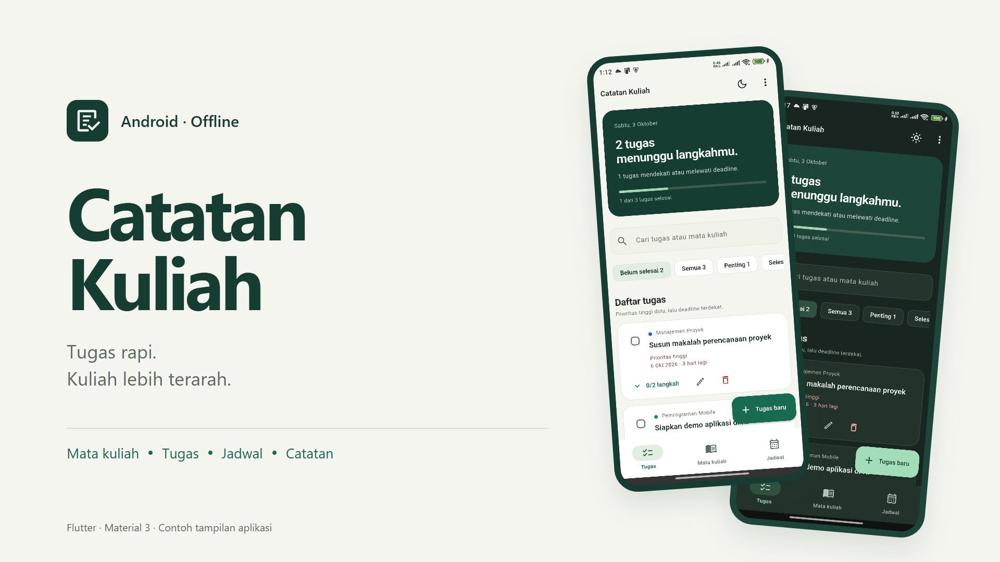
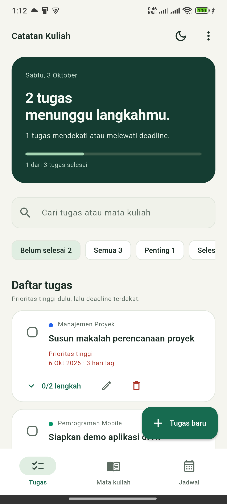
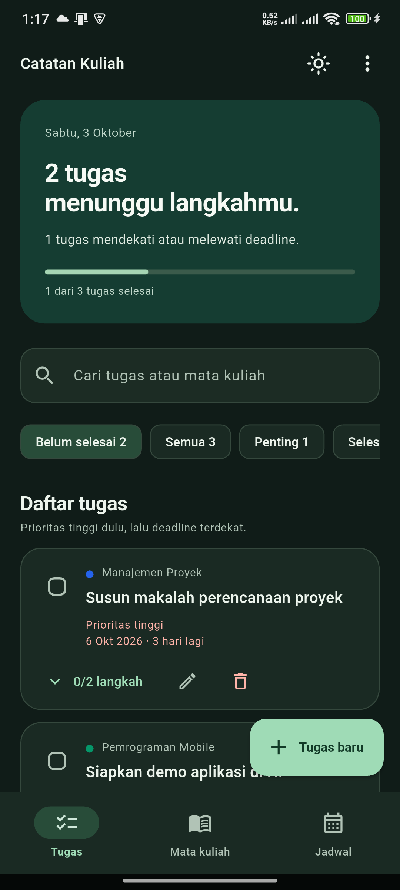

# Catatan Kuliah

Aplikasi Android offline untuk mengelola mata kuliah, tugas, deadline, jadwal, dan catatan. Dibangun dengan Flutter dan Material 3.



## Unduh dan lihat demo

- [APK release 1.0.0](https://github.com/zipzapgg/catatan-kuliah/releases/download/v1.0.0/catatan-kuliah-1.0.0-release.apk) — Android 7.0/API 24 atau lebih baru.
- [Semua berkas release](https://github.com/zipzapgg/catatan-kuliah/releases/tag/v1.0.0) — APK, source ZIP, video, dan paket pengumpulan SeptaLabs.
- [Demo di YouTube](https://youtu.be/fciXPS68KdQ).
- [Video demo MP4](docs/media/demo-catatan-kuliah.mp4) — rekaman perangkat Android dengan keterangan teks, tanpa audio; sekitar 82 detik.

## Fitur

- Daftar tugas lintas mata kuliah, pencarian, filter, prioritas, deadline, dan langkah pengerjaan.
- Hapus satu tugas tanpa menghapus mata kuliah, dengan konfirmasi dan **Urungkan**.
- Mata kuliah dengan jadwal, ruangan, warna penanda, catatan, dan arsip.
- Jadwal mingguan yang tersusun menurut hari dan waktu.
- Pengingat lokal untuk tugas bertanggal, serta tema terang dan gelap.
- Ekspor dan pemulihan cadangan JSON dengan validasi struktur dan hubungan data.

Data disimpan lokal. Pengingat memerlukan izin notifikasi dan tanggal yang dapat dibaca; pengiriman mengikuti pengaturan sistem Android. Sinkronisasi cloud belum tersedia.

## Tampilan

| Daftar tugas | Tema gelap |
| --- | --- |
|  |  |

[Mata kuliah](docs/media/screenshots/02-mata-kuliah.png) · [Jadwal](docs/media/screenshots/03-jadwal.png) · [Detail](docs/media/screenshots/04-detail.png) · [Formulir tugas](docs/media/screenshots/05-form-tugas.png)

Screenshot dan video memakai contoh data pada aplikasi demo terpisah.

## Menjalankan

Lingkungan yang dipakai: Flutter 3.41.4, Dart 3.11.1, JDK 17, dan Android SDK.

```powershell
flutter pub get
flutter analyze --no-pub
flutter test --no-pub
flutter run
```

## Build Android

```powershell
.\scripts\build_android.ps1 -Mode debug
```

Untuk release, buat keystore pribadi, salin `android/key.properties.example` menjadi `android/key.properties`, lalu isi konfigurasi signing. Jangan commit keystore atau password.

```powershell
.\scripts\build_android.ps1 -Mode release
```

Gunakan parameter `-Jdk` pada script jika Java di PATH berbeda dengan JDK yang dibutuhkan. Kunci release dan data pengguna tidak disertakan dalam repository.

APK release memakai tanda tangan berbeda dari build debug. Ekspor cadangan JSON pada aplikasi lama sebelum reinstall apabila Android menolak pembaruan karena tanda tangan berbeda.

## Validasi

- 51 tes otomatis lulus; analisis Flutter tanpa temuan.
- Layout diuji pada empat ukuran layar, kedua tema, dan skala teks hingga 2×.
- Alur hapus/Urungkan dan navigasi diperiksa pada perangkat Android.
- Signature v2, identitas paket, versi, SDK, dan arsitektur APK release diperiksa. APK release tidak menggantikan instalasi debug utama pada HP pengujian.

## Dokumentasi

- [Arah desain](DESIGN.md)
- [Panduan pengumpulan SeptaLabs](PANDUAN_SEPTALABS.md)
